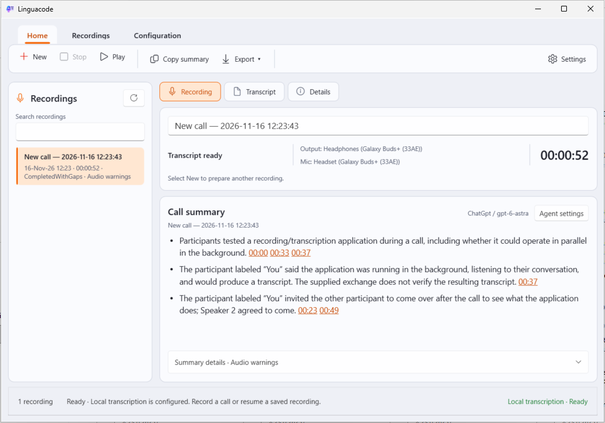

# Linguacode



Linguacode is a Windows app that turns recorded calls into searchable transcripts and summaries. Record a conversation, review who said what, and jump from the text back to the audio.

## What it does

- Records your microphone and computer audio as separate tracks.
- Transcribes speech in multiple languages and labels speakers.
- Lets you search transcripts, rename speakers, and play back any passage.
- Creates summaries with clickable timestamps and translates selected passages.
- Exports transcripts as text or subtitles, plus summaries and recorded audio.

## How it works

Audio is recorded on your PC. After recording, Whisper transcribes it locally, and a separate local model estimates speaker changes. The app downloads the required models during setup; once ready, recording and transcription work offline without an account.

Summaries and translations use the model you choose in **Configuration**. These features pass transcript text to that model, which can run locally or through an online provider. Audio processing stays local.

Recordings, models, and settings are stored in `%LOCALAPPDATA%\Linguacode`, separately from the app. Python is not required.

## Build and run

Requires Windows x64 and **Visual Studio 2026** with the **.NET desktop development** workload. Open `Linguacode.slnx`, set **Linguacode.Desktop** as the startup project, and build or press F5.

Alternatively, with **.NET SDK 10.0.400** or a later 10.0.4xx patch:

```powershell
dotnet build .\Linguacode.slnx -c Release
```

Run `build\Release\Linguacode.exe`. Keep the whole build folder together when copying it to another location or PC; it includes the runtime and audio components.

See the [user guide](CALL_RECORDER.md) for settings and everyday use, [release instructions](RELEASING.md) for packaging, and [third-party notices](THIRD_PARTY_NOTICES.md) for licenses.
